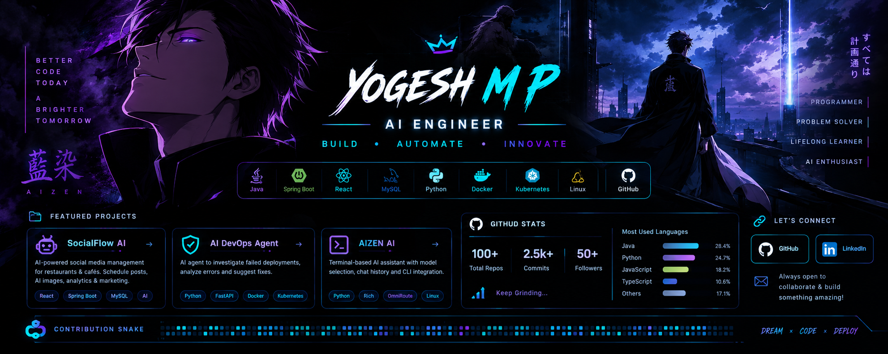

👋 Hey, I'm Yogesh M P!

🚀 Aspiring AI Engineer | Full-Stack Developer | Cybersecurity Enthusiast

  

  

  
  
  

---

🧑‍💻 About Me

- 🎓 Computer Science student specializing in Security Systems.
- 🤖 Interested in Artificial Intelligence, AI Agents, and Automation.
- 💻 Building full-stack applications using Java, Spring Boot, React, and MySQL.
- 🛠️ Exploring DevOps, Docker, Kubernetes, GitHub Actions, and MCP.
- 🔐 Interested in Cybersecurity and Ethical Hacking.
- 🌱 Continuously learning, building, and improving my development skills.
- 🎯 Goal: Become an AI Engineer and build useful real-world solutions.
- ⚡ Motto: Learn by building. Improve by experimenting.

---

🚀 Featured Projects

🤖 AI DevOps Agent

An AI-powered agent designed to investigate failed deployments, analyze errors, and suggest possible fixes.

Tech Stack: Python · FastAPI · GitHub Actions · Docker · Kubernetes · MCP · OmniRoute

🔗 "View Repository" (https://github.com/yogesh201206/AIDevOps)

📱 SocialFlow AI

An AI-powered social media management platform designed for restaurants and cafés to manage posts, scheduling, campaigns, and analytics.

Tech Stack: React · Vite · Java · Spring Boot · MySQL · AI Integration

🔗 "View Repository" (https://github.com/yogesh201206/social-ai)

🧠 AIZEN AI

A terminal-based AI assistant project focused on model selection, chat history, command-line interaction, and integration with AI APIs.

Tech Stack: Python · Rich · Requests · OmniRoute · Linux · WSL

🔗 "Explore My GitHub" (https://github.com/yogesh201206?tab=repositories)

---

🛠️ Tech Stack & Tools

💻 Programming Languages

  

🌐 Frontend Development

  

⚙️ Backend & Database

  

☁️ DevOps & Development Tools

  

🤖 AI & Security

- AI API integration and AI-assisted application development
- AI agents and LLM-powered workflows
- Cybersecurity fundamentals and ethical hacking
- Learning MCP and AI-powered DevOps automation

---

📊 GitHub Statistics

  
  

  

---

🐍 Contribution Graph

  

---

🎯 Current Goals

- [x] Build real-world full-stack projects.
- [x] Explore AI-powered application development.
- [x] Start building an AI DevOps Agent.
- [ ] Strengthen Java and Spring Boot skills.
- [ ] Improve Data Structures and Algorithms.
- [ ] Learn React in greater depth.
- [ ] Explore advanced AI agents and LLM integrations.
- [ ] Build and deploy more production-ready applications.

---

🤝 Connect With Me

  
  

  💬 Always open to learning, collaborating, and building innovative projects.

---

  

  <b>⭐ Thanks for visiting my profile! Let's build something amazing together.</b>

